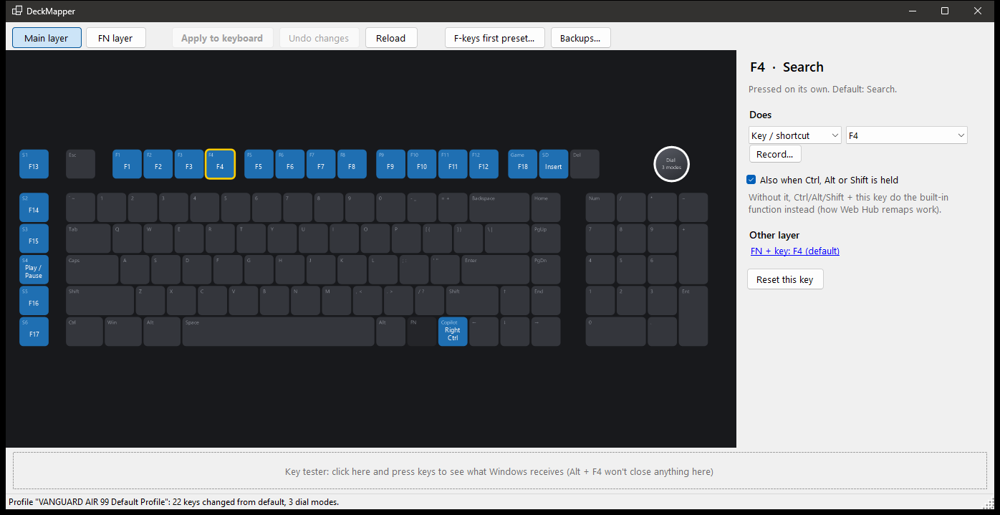
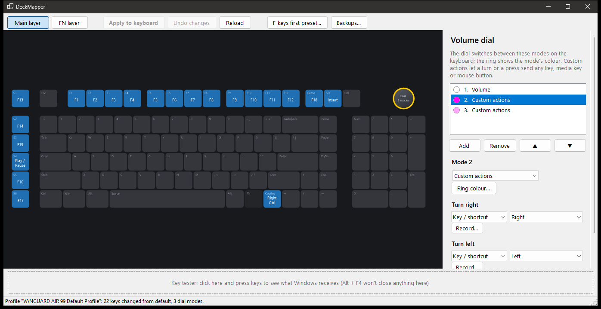

**Remap the keys, the FN layer and the dial on your Corsair VANGUARD AIR 99. No iCUE required.**

Click a key, pick what it does, press **Apply to keyboard**. Everything is saved on the keyboard itself, so it keeps working with DeckMapper closed.

## Alt + F4, with one hand again

Remap F4 to F4 in Web Hub and plain F4 works, but **Alt + F4 doesn't**. You're back to Alt + FN + F4.

That's because the keyboard keeps a separate layer for every modifier, and Web Hub only fills in the "key alone" one. With Alt held, the key quietly falls back to its media function. DeckMapper fills in the Ctrl, Alt and Shift layers too, so remapped keys behave like real keys. Keys that still have the gap get an orange corner, and **Fix them all** sorts every one of them in a click.

## What's inside

- ⌨️ **Main and FN layers.** Any key can send another key, a shortcut (just record it), a media or app key, or nothing at all.
- 🎛️ **Volume dial.** Add, remove, reorder and recolour its modes, or give it your own actions for turn left, turn right and press.
- 🔁 **Macros.** Record what you type, timing included, or build it step by step. Play once per press, or run while held.
- 🅵 **F-keys first preset.** F1–F12 are F-keys, FN + F7–F12 are media. One click.
- 🧪 **Key tester.** See exactly what Windows receives, with a short history, and Alt + F4 can't close anything in there.
- 💾 **Backups.** Your current setup is saved before every write, and **Backups…** puts any of them back.

It leaves your lighting, profiles and screen alone.

## Get it running

1. Download **DeckMapper.exe** below.
2. Install the [.NET 10 Desktop Runtime](https://dotnet.microsoft.com/download/dotnet/10.0) if you don't have it.
3. Plug the keyboard in with the **USB cable** and close iCUE. Fully. Check the tray.
4. Run it.

## Good to know

- Key changes need the **USB cable**. The wireless receiver doesn't let anything talk to the keyboard, Web Hub included.
- The keyboard's macros can only press keys and wait. Mouse clicks, scrolling and mouse moves don't play on it, so DeckMapper doesn't offer them.
- Web Hub's "play once" setting makes this keyboard loop a macro forever. DeckMapper uses one that really plays once.

Nerdy details: [docs/key-assignment-protocol.md](https://github.com/yourgirljolyne/Deckmapper/blob/main/docs/key-assignment-protocol.md)

> Not affiliated with or endorsed by Corsair. Use at your own risk.
