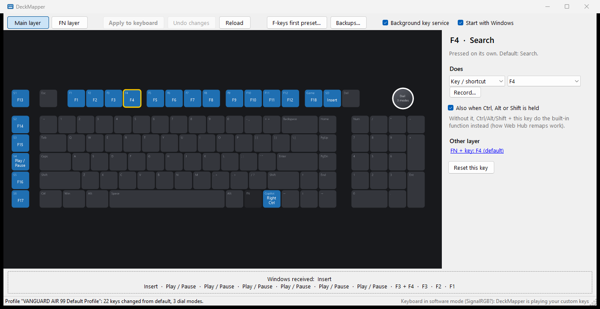

**Your custom keys and SignalRGB's live lighting, at the same time.**

## The problem

For clean live lighting, SignalRGB puts the keyboard in software mode. In software mode the keyboard stops running your remaps and macros itself. Remapped keys go quiet, and the keyboard hands every key press to the PC instead, expecting software to do the rest. That's how iCUE works. Without iCUE, your custom keys simply stopped working while SignalRGB ran.

## The fix: Background key service

DeckMapper now does iCUE's part. Tick **Background key service** at the top of the window and it plays your assignments whenever the keyboard is in software mode:

- **Remapped keys**, held for as long as you hold them, so Alt + F4 and friends behave normally.
- **The FN layer, media keys and mouse buttons.**
- **Macros**, both play once and while held.

When the keyboard runs your keys itself, the service does nothing, so nothing ever fires twice.

It runs quietly in the background: no window and no tray icon, also after you close DeckMapper. Start DeckMapper again to open the window, or untick the box to stop it. **Start with Windows** starts just the service when you sign in.

## Pairs with the SignalRGB plugin

The [SignalRGB plugin for the Air 99](https://github.com/yourgirljolyne/signalrgb-vanguard-air-99) has a new **Custom keys** setting:

- **Played by DeckMapper (clean lighting)**, the default, for use with this service.
- **Kept by the keyboard**, if you'd rather not run DeckMapper. Your keys work, but the keyboard's own stored lighting shows through SignalRGB's.

## Get it running

1. Download **DeckMapper.exe** below.
2. Install the [.NET 10 Desktop Runtime](https://dotnet.microsoft.com/download/dotnet/10.0) if you don't have it.
3. Plug the keyboard in with the **USB cable**.
4. Run it, tick **Background key service** (and **Start with Windows** if you like).

## Good to know

- Custom dial actions aren't played by the service yet. The dial doesn't show up in the keyboard's key reports, so it needs its own work.
- Everything else from 1.0.0 is unchanged: main and FN layers, macros, the dial editor, the key tester and backups.

Nerdy details: [docs/key-assignment-protocol.md](https://github.com/yourgirljolyne/Deckmapper/blob/main/docs/key-assignment-protocol.md)

> Not affiliated with or endorsed by Corsair. Use at your own risk.
